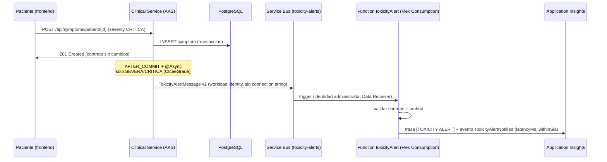

# Serverless: alerta de toxicidad (HU11)

## Flujo



| Garantía | Cómo |
|---|---|
| No se alerta por un reporte que no se guardó | Listener `AFTER_COMMIT` |
| Una falla de mensajería no rompe el reporte del paciente | Publicación asíncrona; errores solo se registran |
| No se pierde un mensaje inválido | Excepción → reintentos → *dead-letter queue* |
| No se alerta por grados bajos | Umbral en productor **y** consumidor (defensa en profundidad) |
| Sin secretos | Service Bus con `disableLocalAuth`; productor y consumidor usan identidades administradas |
| SLA de 60 s medible | `latencyMs` y `withinSla` en cada evento `ToxicityAlertNotified` |

## Configuración

| Dónde | Variable | Valor |
|---|---|---|
| Clinical Service | `SERVICEBUS_NAMESPACE` | `sb-oc3d-dev-xxxxxx.servicebus.windows.net` (output `serviceBusNamespace` de Bicep). Vacío = mensajería desactivada |
| Clinical Service | `ALERT_QUEUE_NAME` | `toxicity-alerts` |
| Clinical Service | `ALERT_CASE_URL_TEMPLATE` | Opcional, p. ej. `https://<frontend>/medico/pacientes/{patientProfileId}` |
| Function App (Bicep) | `ServiceBusConnection__fullyQualifiedNamespace`, `ALERT_QUEUE_NAME`, `APPLICATIONINSIGHTS_CONNECTION_STRING`, `APPLICATIONINSIGHTS_ENABLE_AGENT` | Definidas por `functionapp.bicep` |

## Telemetría (Application Insights → Logs)

```kusto
// Alertas notificadas y cumplimiento del SLA de 60 s
customEvents
| where name == "ToxicityAlertNotified"
| extend latencyMs = todouble(customMeasurements.latencyMs), withinSla = tostring(customDimensions.withinSla)
| summarize alertas = count(), p95_ms = percentile(latencyMs, 95), dentro_sla = countif(withinSla == "true") by bin(timestamp, 1h)

// Mensajes rechazados (contrato inválido) por motivo
customEvents
| where name == "ToxicityAlertRejected"
| summarize count() by tostring(customDimensions.reason)
```

## CI/CD (`.github/workflows/function.yml`)

- PR que toca `functions/**`: build, 17 pruebas unitarias, gate de cobertura (≥ 80 %, actual 89,8 %) y empaquetado.
- `main`: lo mismo y despliegue a la Function App (environment `dev`, con aprobación) autenticando con OIDC
  (identidad `id-gh-clinical-dev`, rol *Website Contributor* sobre `rg-oncontrol3d-dev`).
  Si la infraestructura de dev está apagada, el job avisa y no despliega.

## Pendiente (documentado, no implementado)

| Ítem | Motivo |
|---|---|
| Envío real por correo o push | El canal actual es una traza de prioridad alta en Application Insights, sobre la que se puede configurar una regla de alerta de Azure Monitor. El envío por e-mail (p. ej. Azure Communication Services) se agrega implementando `AlertNotifier` |
| Registrar la alerta en el historial del expediente | Requiere un endpoint nuevo en el Clinical Service (cambio de contrato) |
| HU12, recordatorio de citas (timer trigger) | Requiere que la Function lea citas, por acceso a la base o por una API nueva |
| Outbox transaccional | Hoy, si la app se cae entre el commit y el envío, esa alerta se pierde. Un outbox en PostgreSQL daría entrega *at-least-once* |
