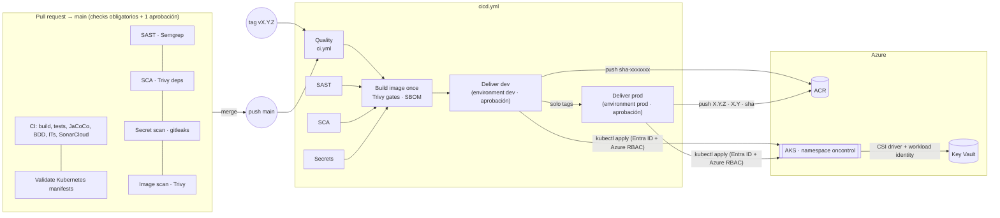
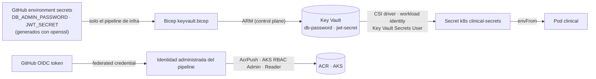

# Pipeline CI/CD — Clinical Service

Mismo diseño en `oncontrol3d-imaging-service`. La infraestructura tiene su propio pipeline
(`oncontrol3d-infra`, `iac.yml`) y la Azure Function el suyo (`function.yml`).

## Diagrama



## Etapas

| # | Etapa | Herramienta | Corta el pipeline si… |
|---|---|---|---|
| 1 | Build + pruebas unitarias | Maven, JUnit 5, Mockito | Falla una prueba (207) |
| 2 | Cobertura | JaCoCo | Cobertura de líneas < 70 % |
| 3 | BDD + integración | Cucumber + Testcontainers (PostgreSQL 16) | Falla un escenario (25) o un IT |
| 4 | Calidad | SonarCloud | Quality gate en rojo (cuando `SONAR_TOKEN` está configurado) |
| 5 | Manifiestos | `deploy/render.sh` + kubeconform | Falta una variable o un recurso no cumple el schema |
| 6 | SAST | Semgrep `p/java` | Hallazgo de severidad ERROR |
| 7 | SCA | Trivy (dependencias) | Cualquier CRITICAL; HIGH con parche |
| 8 | Secretos | gitleaks + `.gitleaks.toml` | Secreto en el árbol actual |
| 9 | Imagen | `docker build` + Trivy + SBOM CycloneDX | CRITICAL en la imagen; HIGH con parche |
| 10 | Deliver dev | ACR + AKS | Falla el rollout (probes) o el smoke test → **rollback automático** |
| 11 | Deliver prod | ACR + AKS | Igual; solo para tags `vX.Y.Z` y con aprobación |

Las etapas 1–8 corren en paralelo cuando es posible (calidad y seguridad son independientes); la imagen
se construye **una sola vez** y el mismo artefacto se promueve a dev y prod.

## Versionado de imágenes

| Evento | Tags en ACR | Ambientes |
|---|---|---|
| push a `main` | `sha-<7 chars>` | dev |
| tag `vX.Y.Z` | `X.Y.Z`, `X.Y`, `sha-<7 chars>` | dev → prod |

El manifiesto referencia la imagen **por digest** (`repo@sha256:…`): lo desplegado es exactamente lo
escaneado, aunque un tag se mueva. Los tags que no cumplen SemVer hacen fallar el pipeline.

## Flujo de secretos



- **Ningún secreto de la aplicación pasa por el pipeline de la aplicación** ni por los manifiestos: el pod
  los lee de Key Vault con su propia identidad (`id-oc3d-<env>-clinical`).
- **No hay credenciales de Azure en GitHub**: los jobs se autentican con OIDC (token de corta duración,
  *subject* atado a la organización, el repositorio y el environment por IDs inmutables).
- **AKS sin cuentas locales**: Entra ID + Azure RBAC. El pipeline de la aplicación tiene *AKS RBAC
  Admin* (no puede crear namespaces); el namespace lo crea el pipeline de infraestructura con Pod
  Security *restricted*.
- La configuración no secreta (ACR, Key Vault, JDBC, Service Bus, client ID) se lee de los **outputs
  del último despliegue de IaC**: una sola fuente de verdad.

## Despliegue en AKS (`deploy/`)

| Archivo | Contenido |
|---|---|
| `k8s/clinical.yaml` | ServiceAccount (workload identity), SecretProviderClass (Key Vault), Deployment, Service |
| `env/dev.env`, `env/prod.env` | Réplicas y recursos por ambiente (prod: 2 réplicas, `maxUnavailable: 0`) |
| `render.sh` | Sustitución controlada (`envsubst` con lista explícita); falla si falta una variable |

Probes: `startupProbe` (hasta 3 min para el arranque de Spring Boot), `readinessProbe` y `livenessProbe`
sobre `/health`. Pod: no root (uid 10001), `readOnlyRootFilesystem`, sin capabilities, `seccomp
RuntimeDefault`, `/tmp` en `emptyDir`.

## Filtros por ruta

- El frontend vive en su propio repositorio: sus cambios nunca disparan estos workflows.
- `cicd.yml` ignora `docs/**`, `**/*.md` y `functions/**` (la Function tiene su propio workflow).
- GitHub no evalúa filtros de ruta en los push de tags: un release siempre corre completo.

## Environments

| Environment | Origen permitido | Aprobación | Identidad |
|---|---|---|---|
| `dev` | rama `main` | Sí (cada despliegue consume crédito de Azure for Students) | `id-gh-clinical-dev` |
| `prod` | tags `v*` | Sí | `id-gh-clinical-prod` |

## Release v1.0.0

Requisitos: PRs de los bloques mergeados en `main`, infraestructura desplegada y los checks en verde.

```bash
git switch main && git pull --ff-only
git tag -a v1.0.0 -m "OnControl3D Clinical Service 1.0.0 - Tercer Avance"
git push origin v1.0.0
```

Corre el pipeline completo, publica `1.0.0`, `1.0` y `sha-…`, despliega en dev y queda esperando la
aprobación de `prod`. Mientras la infraestructura de prod no exista (crédito de estudiante), el job de prod
termina con un aviso y sin desplegar.

## Pendiente

| Ítem | Motivo |
|---|---|
| Exposición pública HTTPS (ingress + certificado) | El Service es `ClusterIP`. Para la demo: `kubectl port-forward` o el add-on *application routing* de AKS con un dominio |
| Orthanc y frontend en el cluster | Componentes de terceros/otro repo; se despliegan aparte |
| `/health` sin chequeo de base de datos | Readiness no detecta una BD caída; mejora: Spring Boot Actuator `health/readiness` |
